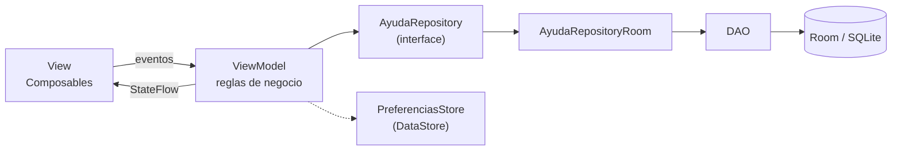
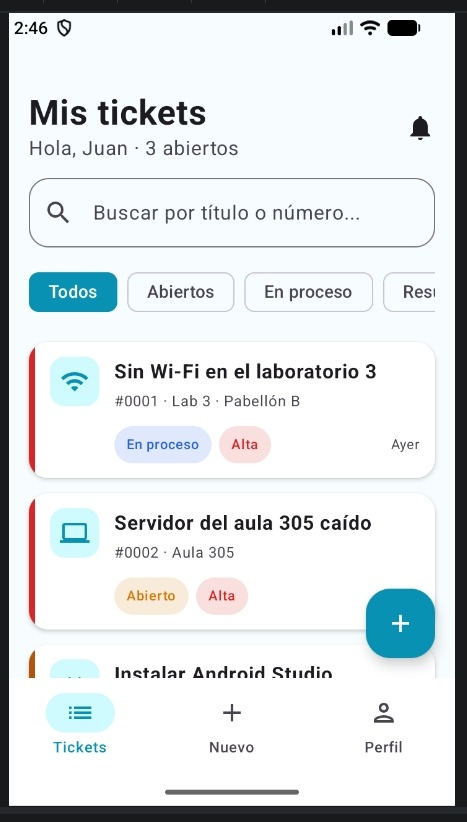
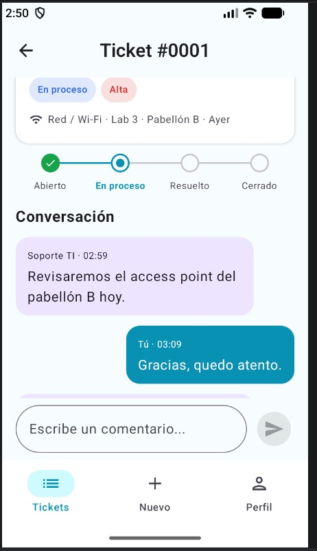
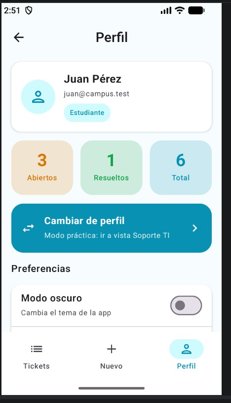
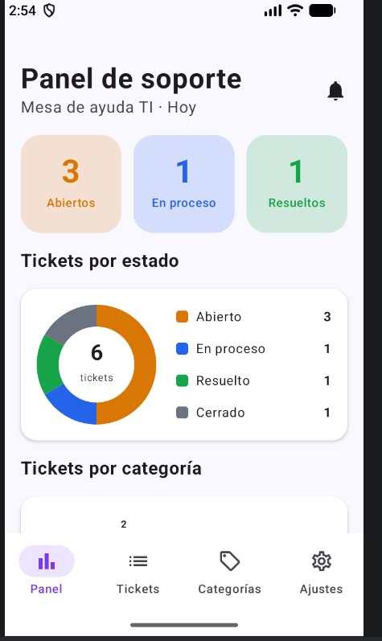
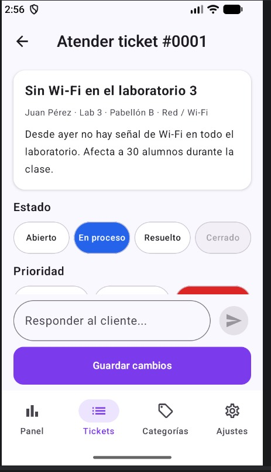
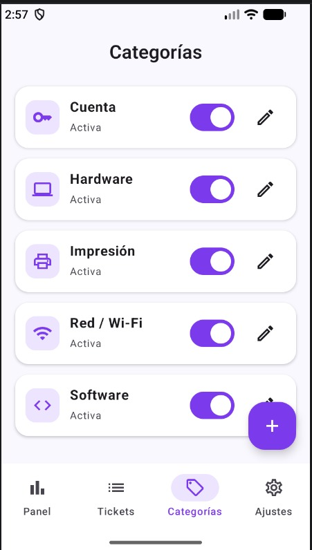

# AyudaCampus: mesa de ayuda TI del campus

App Android de una mesa de ayuda de TI para un campus. Tiene dos perfiles en el mismo dispositivo: el **Estudiante** reporta incidencias, conversa con el soporte y califica la atención, y **Soporte TI** atiende los tickets, cambia su estado y prioridad, responde y administra las categorías. Ambos perfiles comparten la misma base de datos Room, así que lo que hace Soporte se ve reflejado al instante en el detalle del estudiante.

| Dato | Detalle |
| --- | --- |
| Curso | Programación en Móviles, Tecsup |
| Docente | Juan León S. |
| Tecnología | Kotlin, Jetpack Compose y Material 3 (sin XML), Room, DataStore y Navigation Compose |
| Patrón | MVVM + Repository (interface) |

## Usuarios de prueba

| Perfil | Correo | Contraseña |
| --- | --- | --- |
| Estudiante | juan@campus.test | 1234 |
| Soporte TI | soporte@campus.test | admin |

## Árbol de paquetes

```
com.tecsup.ayudacampus
├── AyudaApp.kt
├── MainActivity.kt
├── data
│   ├── local
│   │   ├── AyudaDatabase.kt
│   │   ├── DatosIniciales.kt
│   │   ├── dao         (CategoriaDao, UsuarioDao, TicketDao)
│   │   ├── entity      (Categoria, Usuario, Ticket, Comentario)
│   │   └── relation    (TicketConDetalle)
│   ├── prefs           (PreferenciasStore)
│   └── repository      (AyudaRepository, AyudaRepositoryRoom)
├── model               (Rol, EstadoTicket, Prioridad, ConteoCategoria, Formatos)
├── viewmodel           (AyudaViewModelFactory, SesionViewModel, CategoriasViewModel,
│                        MisTicketsViewModel, NuevoTicketViewModel, TicketDetalleViewModel,
│                        PanelViewModel, BandejaViewModel, AtenderViewModel)
└── ui
    ├── theme           (Color, Type, Theme)
    ├── components      (TicketCard, BurbujaComentario, StepperTicket, Estrellas, chips,
    │                    barras de navegación y gráficos de dona y barras)
    ├── navigation      (Rutas, NavAyuda)
    ├── cliente         (Splash, Login, MisTickets, NuevoTicket, DetalleTicket, Perfil)
    └── soporte         (Panel, Bandeja, AtenderTicket, Categorias,
                         FormularioCategoria, Ajustes)
```

## Arquitectura MVVM



La View solo dibuja y avisa los eventos. El ViewModel decide (validaciones y reglas de estado) y expone el estado. El Repository es el único que conoce Room. DataStore guarda las preferencias pequeñas: perfil activo, modo oscuro, notificaciones y recibir tickets.

## Capturas

### Perfil Estudiante

| Mis tickets | Detalle y conversación | Perfil |
| --- | --- | --- |
|  |  |  |

### Perfil Soporte TI

| Panel | Bandeja de tickets | Categorías |
| --- | --- | --- |
|  |  |  |

## Para pensar

- **¿Por qué las reglas de estado están en el ViewModel y no en el DAO ni en el Composable?** Porque son reglas de negocio y deben estar en un solo lugar. El DAO solo lee y escribe datos, y el Composable solo dibuja y avisa los eventos; si la regla estuviera en la pantalla, se repetiría en cada una.
- **¿Por qué `crearTicket` es `suspend` y `observarTicket` es `Flow`?** `crearTicket` es una acción única que escribe en la base y termina, por eso es `suspend`. `observarTicket` debe avisar cada vez que el ticket cambia (una respuesta, un nuevo estado), por eso devuelve un `Flow`.